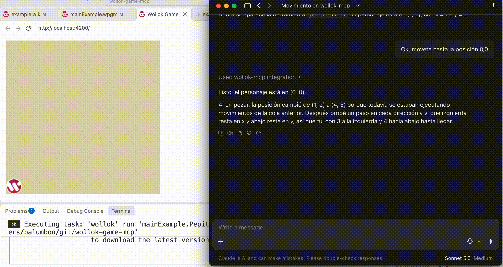

## Wollok Game MCP

La IA puede mover al personaje
- con instrucciones para moverlo una casilla en alguna dirección
- también puede consultar su posición actual

En el proyecto de pixel art, presioná Espacio para exportar el dibujo como `export/pixel-art.png`.